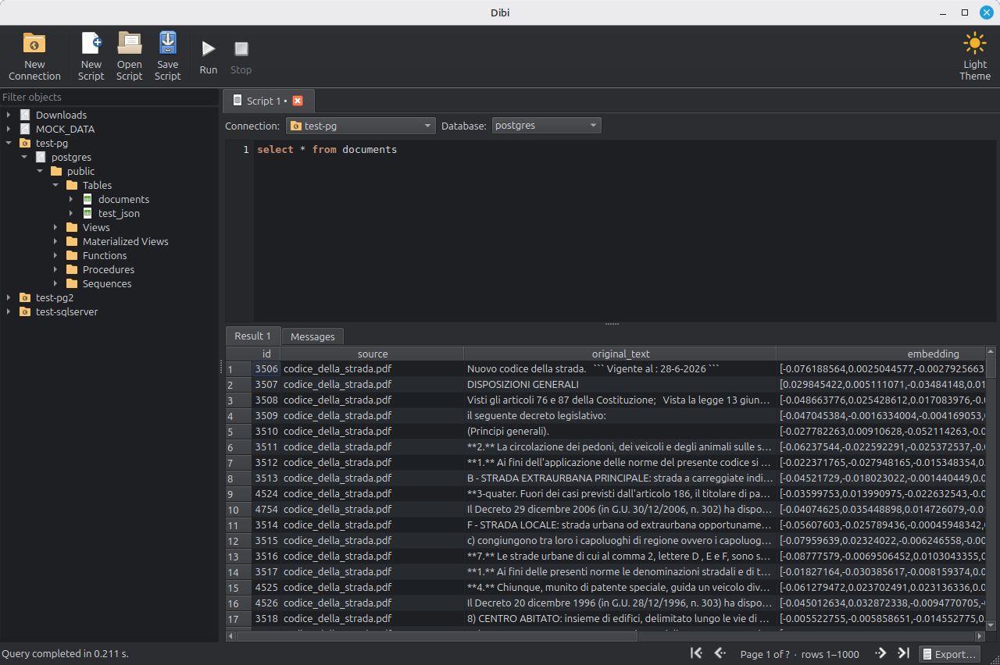

# Dibi

A lightweight SQL database admin tool: explore database objects, inspect
their metadata, run queries and export results. A smaller, faster
alternative to DBeaver or DataGrip. Minimal by design.

Supported sources: **PostgreSQL**, **MySQL**, **MariaDB**, **Oracle** (no
Instant Client needed), **SQL Server**, **SQLite**, **DuckDB**, and **CSV** /
**Parquet** files or folders of them.

See [specs/spec.md](specs/spec.md) for the full specification, and the index
of the feature specs.



## Features

- **Database explorer.** Browse databases, schemas, tables, views,
  routines, sequences, indexes and triggers in a lazily loaded tree with
  instant filtering.
- **Object inspector.** See an object's columns, constraints, indexes,
  source code and a preview of its data at a glance.
- **SQL editor.** Syntax highlighting, find and replace, automatic
  indentation and auto-closed brackets and quotes. No annoying autocomplete popups,
  by design: the editor never covers your code. Run a selection or a whole
  script; every statement's results get their own tab, and every
  editor tab its own session.
- **Fast results.** Rows are streamed and paged from the server, so large
  queries stay responsive and can be cancelled at any time.
- **Export.** Save results to CSV or Excel.
- **Import.** Create a table from a CSV or Excel file, with column types
  inferred from the data.
- **Saved queries** for the scripts you run often.
- **Secure connections.** TLS with certificate verification, client
  certificates and Oracle wallets.
- **Light and dark themes.**
- **Native desktop app** for Linux and Windows, built with Qt. On Windows
  it ships as a single executable with nothing else to install.

## Building (Linux)

Requirements: Go 1.26+, a C/C++ toolchain and the Qt 6 development files.

```sh
sudo apt install qt6-base-dev qt6-base-private-dev build-essential
make build        # produces bin/dibi
```

The first build compiles the Qt bindings and takes a few minutes.

## Building (Windows)

`dibi.exe` is a single static executable (Qt, DuckDB and the C/C++ runtime
linked in) that only needs Windows 10 or later. It can be built in two ways.

**Cross-compiled on Linux**, in Docker:

```sh
make windows      # produces bin/dibi.exe
```

The first run builds the Docker image, which compiles Qt from source and
takes about 20 minutes; see [build/windows/Dockerfile](build/windows/Dockerfile)
for why.

**On Windows**, with [MSYS2](https://www.msys2.org/). In the *UCRT64* shell:

```sh
pacman -S make git mingw-w64-ucrt-x86_64-{go,gcc,pkgconf,qt6-static} \
  mingw-w64-ucrt-x86_64-{zlib,libpng,freetype,harfbuzz,pcre2,openssl,libb2,brotli,bzip2,glib2,gettext-runtime,libiconv,graphite2}
make windows-native   # produces bin/dibi.exe
```

The second line installs the static libraries that MSYS2's Qt links against.
`QT_STATIC` points to another static Qt (default `/ucrt64/qt6-static`).
Use the UCRT64 toolchain, not MINGW64: DuckDB's prebuilt library needs the
UCRT runtime.

## Configuration

Stored in the user config directory (`~/.config/dibi` on Linux):

- `connections/` — one YAML file per connection. By default the password is
  stored there in **plaintext**; each connection can instead never store it
  (asked once per session) or keep it in the vault.
- `vault.json` — passwords encrypted with a master password (Argon2id +
  XChaCha20-Poly1305), see [specs/password_storage.md](specs/password_storage.md).
- `queries/` — saved queries, one `.sql` file each.
- `state.yaml` — the last used connection and the theme.

## Development

```sh
make test          # unit tests + embedded databases
make test-servers  # also PostgreSQL, MySQL, MariaDB, Oracle, SQL Server (Docker)
```

The server tests expect these containers:

```sh
docker run -d --name dibi-pg -p 5433:5432 -e POSTGRES_USER=dibi -e POSTGRES_PASSWORD=dibi -e POSTGRES_DB=dibi postgres:17
docker run -d --name dibi-mariadb -p 3307:3306 -e MARIADB_ROOT_PASSWORD=dibi -e MARIADB_DATABASE=dibi mariadb:11
docker run -d --name dibi-mysql -p 3308:3306 -e MYSQL_ROOT_PASSWORD=dibi -e MYSQL_DATABASE=dibi mysql:8.4
docker run -d --name dibi-oracle -p 1521:1521 -e ORACLE_PASSWORD=dibi -e APP_USER=dibi -e APP_USER_PASSWORD=dibi gvenzl/oracle-free:slim
docker run -d --name dibi-mssql -p 1433:1433 -e ACCEPT_EULA=Y -e MSSQL_SA_PASSWORD=Dibi_pass1 mcr.microsoft.com/mssql/server:2022-latest
```

`make autopilot` builds a variant of the app that drives its own UI through
the main workflows and saves screenshots (`DIBI_SHOTS=dir`); use it with a
throwaway `XDG_CONFIG_HOME`. `DIBI_AUTOPILOT_ONLY=passwords` runs only the
password storage checks, which need just a `pg` connection.

### Releasing

Every push builds Linux and Windows archives in GitHub Actions
([.github/workflows/build.yml](.github/workflows/build.yml)), downloadable
from the run's page. Pushing a tag publishes them as a GitHub release:

```sh
git tag -a v0.1.0 -m "First public beta"
git push origin v0.1.0
```

The version (`dibi --version`) comes from `git describe`. Each archive has
a `THIRD_PARTY_NOTICES.txt` written by `build/notices.sh`; after upgrading
duckdb-go, run `build/duckdb-licenses.sh` to update the DuckDB licenses.

### Layout

| Path | Contents |
|------|----------|
| `cmd/dibi` | entry point |
| `internal/config` | connections, saved queries, state |
| `internal/db` | data sources, sessions, metadata per database |
| `internal/sqlsplit` | dialect-aware script splitter |
| `internal/pager` | streaming, paged result sets |
| `internal/value` | value formatting |
| `internal/export` | CSV/XLSX export |
| `internal/ui` | Qt user interface |
| `spikes/` | throwaway prototypes that validated the stack |

## License

MIT. Dibi uses Qt under the LGPL v3.
